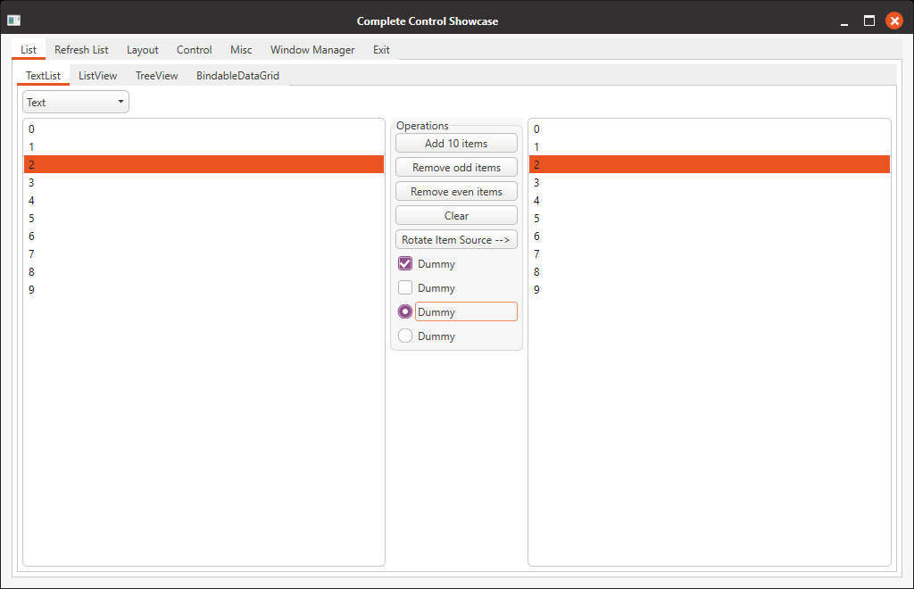
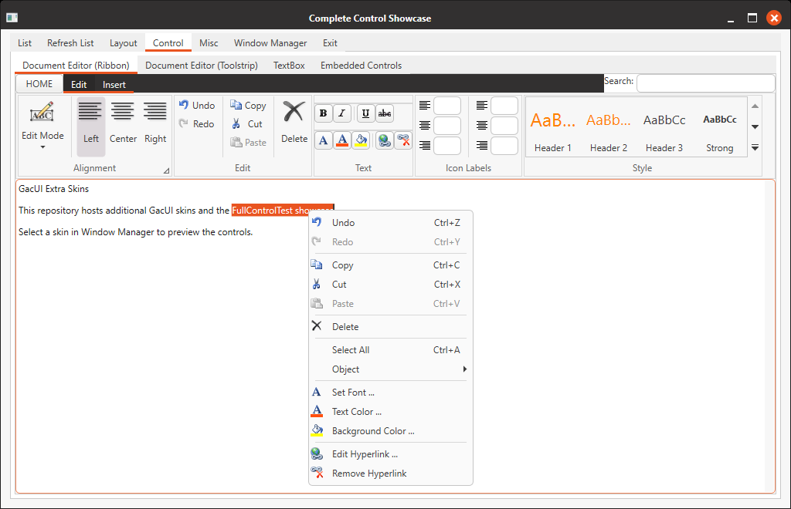

# GacUI Extra Skins

This repository hosts additional GacUI skins and the `FullControlTest` showcase.
FullControlTest starts with the built-in `DarkSkin`. Select another appearance
under **Window Manager → Color Theme**. The [skin index](spec/README.md)
lists the available designs and palettes.

## Using skins in your projects

Compile a skin’s configuration and generated sources alongside GacUI. Select its
color package and register its theme before creating controls. See the
[Vista integration example](doc/WinVistaSkin.md) and
[FullControlTest build instructions](doc/FullControlTest.md).

## Screenshots

FullControlTest at 96 DPI. Select a thumbnail to open the full-size capture.

| Appearance | Selected checkbox and radio | Data grid | Ribbon context menu | Toolstrip File menu |
| --- | --- | --- | --- | --- |
| Windows Vista Aero |  |  |  |  |
| Ubuntu Yaru Standard (20.04) |  |  |  |  |
