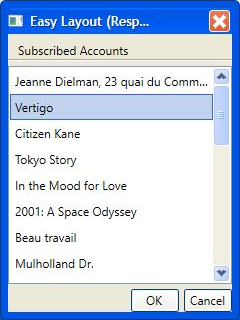
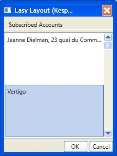

# Responsive movie rows keep their expanded height after shrinking

The FullControlTest movie list retains its detailed row height when returned to the
compact layout. DarkSkin, Win7Skin, Win8Skin and WinXPSkin all showed the behavior.

## Repro

Start `FullControlTest /D2D /Hosted` and open **Layout / Easy Layout (Responsive)**.
The `ResponsiveWindow` scenario performs the same sequence.
[<GacUI-repo>/Test/UIA_CppTest_Shared.cs](https://github.com/vczh-libraries/GacUI/blob/master/Test/UIA_CppTest_Shared.cs).

1. At the initial 240-by-320 client size, select **Vertigo**. Compact movie rows measure 26 pixels.
2. Resize directly to 680 by 320. The detailed rows show an image, title and author
   and measure 106 pixels. Scroll the movie list to the end and back to the top.
3. Resize directly back to 240 by 320. The authors and images disappear and the
   account menu returns. The rows retain their 106-pixel height. The automation tree
   reports three movie rows compared with nine initially. The check
   `movie row height follows responsive appearance #0` times out.

Both XP screenshots show the top of the list in a 240-by-320 window with **Vertigo** selected.

| Fresh compact dialog | Compact again after expanding |
| --- | --- |
|  |  |

Win8Skin process 13912 measured successive row bounds of 332–438, 438–544 and 544–650
after shrinking. See `%TEMP%/xgskins-verification/Win8Skin/ResponsiveWindow.log` and
`responsive-shrink-failure.json`. The XP process 27980 failure is in
`%TEMP%/xgskins-winxp-ResponsiveLevelsResume.log`,
`xgskins-winxp-responsive-height-failure.json` and the
`ResponsiveWindow-20261118-190354-240/uia-timeout.json` verification artifact. A
separate `ResponsiveRemaining` continuation passed 877 assertions for other
appearances, accounts, the footer, selection and modal closure. Its log is
`%TEMP%/xgskins-winxp-ResponsiveRemaining.log`. The compact-row check still fails in
the current hosted XP build.
[XP verification](../../doc/WinXPSkinVerification.md#easy-layout-and-responsive-continuations).

## Workaround

N/A

## Root Cause

Source inspection points to the fixed-height row cache. The recorded runs did not
trace the execution path in a debugger.

- The showcase's `movieGroup.CurrentLevelChanged` handler calls
  `movieList.Arranger.ReloadVisibleStyles()` after changing the responsive level.
- In
  [<GacUI-repo>/Source/GraphicsComposition/GuiGraphicsRepeatComposition_Virtual.cpp](https://github.com/vczh-libraries/GacUI/blob/master/Source/GraphicsComposition/GuiGraphicsRepeatComposition_Virtual.cpp),
  `GuiVirtualRepeatCompositionBase::ReloadVisibleStyles` recreates visible
  styles while deliberately retaining the measured extent. It calls
  `InvalidateLayout`, which does not invalidate the item-size cache.
- `GuiRepeatFixedHeightItemComposition::Layout_BeginPlaceItem` starts with the
  cached `rowHeight`. `Layout_PlaceItem` only increases that height to fit a
  larger preferred size. A replacement compact row therefore cannot reduce
  the retained height. `OnStyleCachedMinSizeChanged` also only invalidates the
  layout. The imported implementation used by this repository has the same
  behavior.

## Proposal

Allow a visible-style reload or a preferred-size decrease to remeasure the
fixed-height row cache after replacement styles have valid measurements.
Preserve the scroll anchor and previous extent until that measurement is ready:
the existing reload comment explicitly guards against provisional text sizes
clamping the scroll position of a hidden list. Unconditionally resetting the
layout before measuring would risk reintroducing that problem.

Keep the existing direct compact-to-detailed-to-compact assertion, and add a
focused virtual-repeat regression that changes visible item preferred heights
from 26 to 106 and back to 26. Verify the row height, realized item count,
selection, and scrolling at the start and end of the list. Include a hidden-list
reload case to ensure provisional text measurements do not lose the scroll
anchor. Run the showcase regression with DarkSkin, Win7Skin, Win8Skin and
WinXPSkin.
